# Base de conocimiento del proyecto
## Sistema de gestión clínica bariátrica

**Tipo de documento:** fuente de verdad funcional y técnica  
**Versión:** 1.0  
**Última actualización:** 26 de octubre de 2026  
**Estado:** base inicial consolidada; contiene decisiones confirmadas y pendientes explícitos.

---

## 1. Propósito y reglas de uso

Este documento reúne el conocimiento acordado del proyecto para orientar el análisis, diseño, implementación, pruebas y mantenimiento del sistema de gestión clínica bariátrica.

Debe utilizarse como referencia principal durante el desarrollo. No obstante, no se deben presentar como requisitos confirmados los puntos marcados como `PENDIENTE`, `PROPUESTA` o `POR VALIDAR`.

### 1.1 Estados de conocimiento

- **CONFIRMADO:** decisión expresamente acordada para el proyecto.
- **DERIVADO:** consecuencia necesaria de una decisión confirmada.
- **PROPUESTA TÉCNICA:** diseño recomendado para implementar los requisitos; puede revisarse si existe una razón documentada.
- **PENDIENTE:** requiere decisión o información adicional.
- **POR VALIDAR CLÍNICAMENTE:** dato o fórmula del Excel que debe confirmar el médico antes de implementarse como regla clínica definitiva.

### 1.2 Regla para mantener la fuente de verdad

1. Si una decisión nueva contradice este documento, registrar el cambio antes de modificar el código.
2. No completar vacíos con supuestos silenciosos.
3. Todo requisito nuevo debe vincularse con un caso de uso, una regla de negocio y, cuando corresponda, pruebas.
4. Distinguir los requisitos del negocio de las decisiones técnicas utilizadas para satisfacerlos.
5. Los cambios en fórmulas clínicas requieren validación del médico y pruebas de regresión.
6. Mantener trazabilidad entre requisitos, casos de uso, módulos, modelo de datos y pruebas.

### 1.3 Fuentes utilizadas

- `De los patrones de acceso a las colecciones.xlsx`: patrones de acceso, relaciones, colecciones, índices, integridad y validación.
- `Registro_de_Antropometria y calculo calorico elissa guillen garcia.xlsx`: hoja `ANTOPOMETRIA` y hoja `CALCULO CALORICO`.
- Decisiones confirmadas en la conversación del proyecto: arquitectura modular por funcionalidades, separación de nombres y apellidos, visitas con varios estudios, PDF para documentos externos y entrega, antecedentes familiares limitados a heredofamiliares e historial inmutable.

Los archivos de trabajo orientan el diseño, pero no sustituyen la validación clínica de las fórmulas.

---

## 2. Visión y alcance del sistema

### 2.1 Propósito

Gestionar la información clínica de pacientes de un consultorio de bariatría, incluyendo registro de pacientes, visitas, estudios, mediciones, cálculos, dietas, medicamentos, padecimientos, relaciones familiares, documentos externos y generación de un expediente para entrega.

### 2.2 Actores identificados

- **Médico:** registra pacientes, información clínica, padecimientos, seguimientos, dietas y medicamentos; consulta historiales y antecedentes heredofamiliares; solicita la generación del expediente.
- **Ayudante médico:** registra las mediciones clínicas indicadas por el médico.
- **Paciente:** destinatario del expediente generado. No se ha confirmado que disponga de una cuenta o acceso directo al sistema.

### 2.3 Funcionalidades dentro del alcance

1. Registrar pacientes.
2. Adjuntar expedientes externos en PDF.
3. Registrar visitas con uno o varios estudios de diferentes tipos.
4. Registrar mediciones de los estudios.
5. Consultar historial clínico.
6. Calcular indicadores antropométricos y energéticos a partir del Excel, una vez validados.
7. Registrar dieta y medicamentos asociados a la atención.
8. Clasificar pacientes por padecimiento.
9. Vincular pacientes familiares.
10. Consultar antecedentes heredofamiliares.
11. Generar un expediente en PDF para su entrega.
12. Consultar pacientes por padecimiento.

### 2.4 Fuera de alcance o no confirmado

- Portal o cuenta de acceso directo para pacientes.
- Integración con sistemas externos, laboratorios o aseguradoras.
- Aplicación móvil nativa.
- Firma electrónica.
- Mensajería, recordatorios y agenda de citas.
- Diagnóstico automatizado o recomendaciones clínicas autónomas.
- Corrección o eliminación de visitas y estudios históricos.
- Acceso automático a los expedientes completos de familiares.

No implementar estos elementos como requisitos sin una decisión explícita.

---

## 3. Grafo de conocimiento principal

El siguiente grafo Mermaid representa las relaciones conceptuales principales. Las flechas indican dependencia o relación semántica, no necesariamente llamadas directas entre módulos.

```mermaid
flowchart TD
    PROY[Gestión clínica bariátrica]

    PROY --> ACT[Actores]
    PROY --> UC[Casos de uso]
    PROY --> REQ[Requisitos y reglas]
    PROY --> DAT[Modelo de datos]
    PROY --> ARQ[Arquitectura]
    PROY --> CLIN[Cálculos clínicos]
    PROY --> PEND[Decisiones pendientes]

    ACT --> MED[Médico]
    ACT --> AYU[Ayudante médico]
    ACT --> PAC[Paciente destinatario del expediente]

    UC --> UC01[CU-01 Registrar paciente]
    UC --> UC02[CU-02 Adjuntar expediente externo]
    UC --> UC03[CU-03 Registrar mediciones y estudios]
    UC --> UC04[CU-04 Consultar historial]
    UC --> UC05[CU-05 Registrar seguimiento]
    UC --> UC06[CU-06 Consultar cálculos]
    UC --> UC07[CU-07 Registrar dieta y medicamentos]
    UC --> UC08[CU-08 Clasificar por padecimiento]
    UC --> UC09[CU-09 Vincular familiares]
    UC --> UC10[CU-10 Consultar antecedentes heredofamiliares]
    UC --> UC11[CU-11 Entregar expediente PDF]
    UC --> UC12[CU-12 Consultar pacientes por padecimiento]

    DAT --> PACIENTES[Pacientes]
    DAT --> VISITAS[Visitas]
    DAT --> ESTUDIOS[Estudios]
    DAT --> DOCS[Documentos PDF]
    DAT --> CAT[Catálogo de padecimientos]
    DAT --> FAM[Relaciones familiares]
    VISITAS --> ESTUDIOS
    ESTUDIOS --> MEDICIONES[Mediciones]
    ESTUDIOS --> RESULT[Resultados calculados]
    PACIENTES --> VISITAS
    PACIENTES --> DOCS
    PACIENTES --> FAM
    PACIENTES --> CAT

    REQ --> INM[Historial inmutable]
    REQ --> IDP[Idempotencia y prevención de duplicados]
    REQ --> PERM[Roles y permisos]
    REQ --> RET[Retención mínima de 15 años]
    REQ --> VAL[Validación de datos]
    REQ --> CONS[Consistencia de operaciones]

    ARQ --> MONO[Monolito modular]
    MONO --> FEAT[Módulos por funcionalidad]
    FEAT --> FP[patients]
    FEAT --> FV[visits]
    FEAT --> FC[calculations]
    FEAT --> FD[documents]
    FEAT --> FF[family-history]
    FEAT --> FCOND[conditions]
    FEAT --> FA[auth]

    CLIN --> ANT[Antropometría]
    CLIN --> ENE[Cálculo calórico]
    ANT --> VCLIN[Validación del médico]
    ENE --> VCLIN

    PEND --> PC1[Validar fórmulas del Excel]
    PEND --> PC2[Definir ciclo de vida de una visita]
    PEND --> PC3[Tamaño máximo y metadatos PDF]
    PEND --> PC4[Contenido del expediente PDF]
    PEND --> PC5[Framework y contrato API]
    PEND --> PC6[Definir catálogo y administración]
```



---

## 4. Casos de uso y trazabilidad

| ID | Caso de uso | Actor principal | Módulo principal | Resultado |
|---|---|---|---|---|
| CU-01 | Registrar paciente | Médico | `patients` | Paciente registrado con identificador único |
| CU-02 | Adjuntar expediente externo | Médico | `documents` | PDF almacenado y vinculado al paciente |
| CU-03 | Registrar mediciones clínicas | Ayudante médico | `visits` | Visita y uno o varios estudios con mediciones |
| CU-04 | Consultar historial clínico | Médico | `visits` | Evolución y detalles históricos consultables |
| CU-05 | Registrar seguimiento clínico | Médico | `visits` | Nueva atención registrada sin sobrescribir visitas previas |
| CU-06 | Consultar cálculos antropométricos y calóricos | Médico | `calculations` | Resultados asociados a una visita y sus datos de origen |
| CU-07 | Registrar dieta y medicamentos | Médico | `visits` | Indicaciones asociadas a la atención correspondiente |
| CU-08 | Clasificar paciente por padecimiento | Médico | `conditions` / `patients` | Padecimientos asociados al paciente sin duplicados |
| CU-09 | Vincular pacientes familiares | Médico | `family-history` | Relación familiar consistente en ambos pacientes |
| CU-10 | Consultar antecedentes heredofamiliares | Médico | `family-history` | Antecedentes heredofamiliares disponibles |
| CU-11 | Entregar expediente clínico | Médico | `documents` | Expediente generado en PDF |
| CU-12 | Consultar pacientes por padecimiento | Médico | `conditions` / `patients` | Listado de pacientes asociados al padecimiento |

La especificación detallada de los flujos de estos casos de uso se mantiene en el documento `casos_de_uso.md`. Si ese documento cambia, actualizar también esta tabla.

---

## 5. Reglas de negocio e integridad

### RN-01. Campos obligatorios y tipos

**Estado:** confirmado como regla de diseño; esquema definitivo por colección pendiente.

- Validar campos requeridos, tipos y formatos.
- `alergias` debe distinguir entre una lista vacía —sin alergias conocidas— y la ausencia de información —no preguntado o desconocido—.
- Se recomienda usar validación de esquema en MongoDB y validación de aplicación para reglas que requieren contexto.

### RN-02. Valores permitidos

- El tipo de sangre debe pertenecer al conjunto: `A+`, `A-`, `B+`, `B-`, `AB+`, `AB-`, `O+`, `O-`.
- El tipo de visita, si se conserva la distinción inicial/seguimiento, debe usar valores controlados.
- El vocabulario definitivo de tipos de estudio debe definirse antes de implementar validaciones estrictas.

### RN-03. Rangos de mediciones

El Excel de acceso propone como ejemplos iniciales:

- Peso: 20–400 kg.
- Estatura: 50–250 cm.
- Presión sistólica: 50–300.

Estos valores son ejemplos de validación técnica, no rangos clínicos aprobados. Los límites aplicables a cada medición deben validarse con el médico. No inventar rangos para otros campos.

### RN-04. Evitar visitas iniciales duplicadas

Si el modelo conserva el concepto de visita inicial, se debe impedir que un paciente tenga más de una. La propuesta original es un índice único parcial por `paciente_id` para documentos cuyo `tipo` sea `inicial`.

La estrategia final debe ser compatible con la identidad estable de la visita y con la prevención de reintentos duplicados.

### RN-05. Integridad paciente-visita

Toda visita debe apuntar a un paciente existente. MongoDB no ofrece claves foráneas tradicionales; la aplicación debe verificar la existencia del paciente antes de registrar la visita.

### RN-06. Relaciones familiares bidireccionales

- El parentesco se registra en ambos pacientes.
- Los parentescos inversos deben ser coherentes.
- La actualización de ambos documentos debe ser atómica; usar transacción de MongoDB cuando se despliegue en un entorno compatible.
- Si falla uno de los cambios, no debe quedar una relación parcial.

### RN-07. Padecimientos válidos y sin duplicados

- El médico determina qué padecimientos pertenecen al catálogo.
- La aplicación valida cada código contra el catálogo.
- No se deben duplicar padecimientos en el expediente.
- Puede utilizarse `$addToSet` para evitar duplicados en arreglos.
- La administración del catálogo (alta, desactivación, corrección) requiere definición adicional.

### RN-08. Consistencia de expedientes externos

- Solo se aceptan PDF.
- Primero se almacena el archivo en GridFS y, si la carga concluye correctamente, se guarda su referencia y metadatos.
- Debe existir una estrategia de recuperación para archivos cargados cuyo metadato no se pudo guardar.
- No dejar referencias activas a archivos inexistentes.
- El tamaño máximo y los metadatos obligatorios siguen pendientes.

### RN-09. Escrituras autorizadas por responsabilidad

La propuesta de acceso original separa las mediciones capturadas por el ayudante de las notas, dietas y medicamentos registrados por el médico. Cuando una operación editable esté permitida, actualizar solo los campos autorizados, por ejemplo mediante `$set`, en lugar de reemplazar el documento completo.

**Importante:** esta regla debe reconciliarse con la decisión confirmada de no corregir visitas o estudios anteriores. El ciclo de vida y el momento en que una visita deja de ser editable están pendientes; no se debe habilitar edición histórica.

### RN-10. Consistencia de cálculos y datos de origen

- Cada resultado debe vincularse con la visita y el estudio que proporcionan los datos necesarios.
- No calcular ni guardar un resultado como válido cuando falten datos requeridos.
- Guardar los resultados junto con la operación que registra los datos que los originan, de forma consistente.
- Conservar suficiente información de procedencia para saber qué datos se utilizaron.
- La lista definitiva de cálculos y sus fórmulas requiere validación médica.

### RN-11. Retención de información

- Pacientes, visitas y expedientes deben conservarse durante un mínimo de 15 años según la decisión del proyecto.
- No implementar eliminación física ordinaria de estos registros.
- Aplicar permisos de base de datos que impidan borrar o eliminar colecciones a la cuenta de aplicación.
- La política legal y el evento desde el cual se cuentan los 15 años deben confirmarse con el responsable del consultorio.

### RN-12. Inmutabilidad del historial

- Las visitas y los estudios anteriores no pueden corregirse ni modificarse.
- Las nuevas atenciones se registran como nuevas visitas.
- No usar `replaceOne` ni ofrecer endpoints ordinarios que sobrescriban visitas o estudios históricos.
- La forma de documentar una corrección detectada posteriormente debe definirse con el médico; no sobrescribir silenciosamente el dato original.

### RN-13. Prevención de duplicados por reintentos

- Cada operación de creación de visita debe tener una identidad estable o una clave de idempotencia.
- Un reintento de la misma operación no debe generar otra visita o conjunto de estudios duplicado.
- Deben existir restricciones de unicidad en la base de datos cuando sea posible; una comprobación previa desde la aplicación por sí sola no protege contra todas las condiciones de concurrencia.

### RN-14. Autorización

- Autenticar a los usuarios.
- Autorizar las operaciones según el rol y la responsabilidad.
- Validar los permisos en el backend, no solo en la interfaz.
- Evitar que un usuario modifique campos ajenos a su función.
- El detalle final de roles, permisos y administración de cuentas sigue pendiente.

---

## 6. Modelo conceptual de datos

El modelo conceptual debe reflejar que **una visita puede contener uno o varios estudios de distintos tipos**.

### 6.1 Entidades principales

#### Paciente

Campos conceptuales:

- `id`
- `nombre`
- `apellido_paterno`
- `apellido_materno`
- `fecha_nacimiento`
- `tipo_sangre`
- `alergias`
- `antecedentes_personales`
- `padecimientos`
- `relaciones_familiares`
- `documentos_externos`
- `fecha_registro`

Los nombres y apellidos se almacenan por separado. No usar `nombre_completo` como único campo de identificación. Puede generarse una representación de nombre completo para presentación o búsqueda.

#### Visita

Campos conceptuales:

- `id`
- `paciente_id`
- `fecha`
- `tipo` (por ejemplo, inicial o seguimiento si se confirma esa clasificación)
- `estudios`
- `notas_clinicas`
- `dieta_indicada`
- `medicamentos_indicados`
- metadatos de registro e integridad que se definan durante el diseño técnico

La visita representa una atención en una fecha determinada. No es sinónimo de un estudio.

#### Estudio

Campos conceptuales:

- `id`
- `tipo_estudio`
- `mediciones`
- `resultados_calculados`, cuando aplique
- información de procedencia necesaria para interpretar los datos

Una visita puede contener uno o varios estudios. El catálogo definitivo de tipos de estudio y sus campos específicos debe definirse a partir del Excel y de la validación con el médico.

#### Documento externo

Campos conceptuales:

- `id` o identificador de GridFS
- `paciente_id`
- `filename`
- `content_type` (PDF)
- tamaño
- fecha de carga
- metadatos definidos por el consultorio

El contenido binario se almacenará en GridFS; el expediente del paciente conservará la referencia necesaria.

#### Padecimiento

Campos conceptuales:

- `codigo`
- `nombre`
- estado u otros metadatos si el médico los requiere

El catálogo lo define el médico. La forma de administrarlo queda pendiente.

#### Relación familiar

Campos conceptuales:

- `paciente_id`
- `familiar_id`
- `parentesco`
- datos mínimos necesarios para mantener la relación inversa

La relación debe mantenerse coherente en ambos pacientes. Los antecedentes heredofamiliares no implican acceso a las visitas completas de los familiares.

### 6.2 Relaciones

- Un paciente tiene muchas visitas.
- Una visita pertenece a un solo paciente.
- Una visita contiene uno o varios estudios.
- Un estudio contiene las mediciones realizadas en ese estudio.
- Un estudio puede tener cero o varios resultados calculados, según el tipo de estudio y los datos disponibles.
- Un paciente puede tener varios documentos externos en PDF.
- Un paciente puede estar asociado a varios padecimientos del catálogo.
- Un paciente puede tener relaciones familiares con otros pacientes.
- Las dietas y los medicamentos se asocian a la atención en la que fueron indicados, conservándose como hechos históricos.

### 6.3 Propuesta inicial de persistencia en MongoDB

**Estado:** propuesta técnica, pendiente de diseño físico definitivo.

- `pacientes`: datos de identidad, antecedentes, alergias, padecimientos y referencias familiares/documentales.
- `visitas`: visitas referenciadas por `paciente_id`, con estudios embebidos si el tamaño y la forma de acceso lo justifican.
- `expedientes.files` y `expedientes.chunks`: almacenamiento de documentos mediante GridFS.
- Catálogo de padecimientos: puede ser una colección independiente si requiere administración centralizada.

La elección de embeber estudios dentro de una visita o separarlos en una colección debe considerar la inmutabilidad, el tamaño, la necesidad de consultar estudios individualmente y las transacciones. No crear una colección separada por cada tipo de estudio sin una justificación de acceso.

---

## 7. Patrones de acceso e índices

Los patrones originales identificados son:

| ID | Patrón |
|---|---|
| P1 | Registrar paciente |
| P2 | Adjuntar expediente o antecedentes externos |
| P3 | Registrar mediciones |
| P4 | Consultar historial clínico |
| P5 | Registrar seguimiento |
| P6 | Realizar cálculos |
| P7 | Registrar dieta y medicamentos |
| P8 | Clasificar paciente por padecimiento |
| P9 | Vincular familiares |
| P10 | Consultar antecedentes heredofamiliares |
| P11 | Entregar expediente |
| P12 | Consultar pacientes por padecimiento |

### 7.1 Índices iniciales propuestos

1. Historial por paciente y fecha:
   - `{ paciente_id: 1, fecha: -1 }`
   - Permite recuperar visitas ordenadas de la más reciente a la más antigua.

2. Búsqueda de pacientes:
   - `{ apellido_paterno: 1, apellido_materno: 1, nombre: 1, fecha_nacimiento: 1 }`
   - Aplicar collation española consistente en las consultas de búsqueda y detección de posibles duplicados.
   - No debe ser único, porque pueden existir homónimos.

3. Consulta por padecimiento:
   - Evaluar índice multikey para los códigos de padecimientos.
   - Puede posponerse hasta confirmar volumen de datos y rendimiento requerido.

4. Visita inicial:
   - Si se conserva el concepto, índice único parcial por paciente para las visitas de tipo inicial.

Los índices definitivos deben corresponder al esquema real implementado. Revisar su necesidad mediante patrones de consulta y pruebas de rendimiento, no agregarlos indiscriminadamente.

### 7.2 Historial eficiente

La consulta del historial debe evitar recuperar el detalle completo de todas las visitas en cada apertura.

Estrategia inicial:

- Recuperar un resumen cronológico con fecha y medidas relevantes disponibles, como peso e IMC.
- Mostrar el detalle de las tres visitas más recientes.
- Recuperar el detalle de visitas antiguas bajo demanda.
- Generar el expediente completo solo cuando se solicite.

---

## 8. Cálculos identificados en el Excel

**Advertencia:** los elementos siguientes se identificaron en el archivo proporcionado. No deben considerarse fórmulas clínicas aprobadas hasta que el médico confirme las fórmulas, sus unidades, las condiciones de aplicación y los datos requeridos. El archivo contiene valores de ejemplo y algunas celdas con errores; los datos de pacientes del archivo no forman parte de esta especificación.

### 8.1 Antropometría

| Cálculo o dato | Observación del archivo |
|---|---|
| Peso ideal Lorentz para hombre | Fórmula basada en estatura en centímetros |
| Peso ideal Lorentz para mujer | Fórmula basada en estatura en centímetros |
| Peso ideal Brocca | Estatura en centímetros menos 100 |
| Promedio de peso ideal | Promedio de Brocca y Lorentz, según sexo |
| Porcentaje de peso ideal (%PI) | Peso actual dividido entre el peso ideal de referencia, multiplicado por 100 |
| IMC | Peso en kg dividido entre estatura en metros al cuadrado |
| Complexión | Estatura en centímetros dividida entre circunferencia de muñeca |
| Índice cintura-cadera | Circunferencia de cintura dividida entre circunferencia de cadera |
| Pliegues cutáneos | Bíceps, tríceps, subescapular y suprailiaco |
| Sumatoria de pliegues | Suma de los cuatro pliegues indicados |
| Logaritmo de la sumatoria | Logaritmo base 10 de la suma de pliegues |
| Densidad corporal | En el archivo: `1.1423 - 0.0632 × log10(sumatoria)` |
| Masa grasa | En el archivo se usa una ecuación basada en peso y densidad corporal |
| Masa libre de grasa | Peso actual menos masa grasa |
| Porcentaje de grasa corporal | En el archivo aparece una fórmula atribuida a Siri basada en densidad corporal |
| Área muscular del brazo (AMB) | Calculada a partir de circunferencia de brazo y pliegue tricipital |
| Bioimpedancia | Datos reportados por la báscula, como porcentaje de grasa, masa muscular, IMC, ingesta calórica diaria, edad metabólica y grasa visceral |

### 8.2 Cálculo calórico

| Cálculo | Observación del archivo |
|---|---|
| IMC | Peso / estatura² |
| Gasto energético basal (GEB) | El archivo usa fórmulas diferentes según sexo |
| Efecto térmico de los alimentos (ETA) | En los ejemplos se calcula como 10 % del GEB |
| Factor de actividad (EF) | La hoja menciona 10 %, 20 % y 30 %; los ejemplos usan un porcentaje del GEB |
| Gasto energético total (GET) | Suma de GEB, ETA y EF |
| Restricción calórica | En el ejemplo se resta 500 al GET |

### 8.3 Requisitos antes de programar las fórmulas

Para cada cálculo se debe registrar:

- Nombre y propósito clínico.
- Fórmula aprobada.
- Unidades de entrada y salida.
- Campos requeridos.
- Condiciones en las que no se puede calcular.
- Tratamiento de redondeo y precisión.
- Fuente y versión de la fórmula.
- Casos de prueba validados por el médico.

No deducir ni completar una fórmula ausente a partir de un resultado de ejemplo. Los datos reportados por una báscula deben distinguirse de los resultados calculados por la aplicación.

---

## 9. Arquitectura técnica acordada

### 9.1 Enfoque

**CONFIRMADO:** se toma como base la opción 2, arquitectura por funcionalidades (*feature-based*), con separación interna ligera y límites explícitos entre módulos.

**PROPUESTA TÉCNICA:** implementarla como un monolito modular. No se requiere dividir el sistema en microservicios para el alcance actual.

### 9.2 Estructura base de carpetas

```text
backend/
├── src/
│   ├── config/
│   ├── shared/
│   │   ├── errors/
│   │   ├── logging/
│   │   └── validation/
│   ├── infrastructure/
│   │   ├── database/
│   │   │   └── mongodb/
│   │   ├── storage/
│   │   │   └── gridfs/
│   │   └── pdf/
│   ├── features/
│   │   ├── auth/
│   │   ├── patients/
│   │   ├── visits/
│   │   ├── calculations/
│   │   │   └── formulas/
│   │   ├── documents/
│   │   ├── family-history/
│   │   └── conditions/
│   ├── app.js
│   └── server.js
├── tests/
│   ├── unit/
│   ├── integration/
│   └── e2e/
├── .env.example
├── package.json
└── README.md
```

El framework, el lenguaje, la biblioteca de acceso a MongoDB y el contrato de API aún deben confirmarse. La estructura anterior es una guía de organización, no una decisión sobre una tecnología específica.

### 9.3 Responsabilidades de los módulos

- `auth`: autenticación, autorización y políticas de acceso.
- `patients`: registro, identificación y consulta básica de pacientes.
- `visits`: visitas, estudios, mediciones, notas y datos asociados a la atención.
- `calculations`: fórmulas y resultados clínicos independientes de HTTP y MongoDB.
- `documents`: carga de PDF, GridFS, metadatos y generación del expediente de entrega.
- `family-history`: vínculos familiares y consulta de antecedentes heredofamiliares.
- `conditions`: catálogo de padecimientos y clasificación.
- `shared`: utilidades realmente transversales, sin convertirse en un lugar para lógica de negocio desordenada.
- `infrastructure`: conexión a MongoDB, GridFS y herramientas de generación de PDF.

### 9.4 Reglas de dependencias

1. Los controladores HTTP no realizan consultas directas a MongoDB.
2. Los módulos no importan libremente archivos internos de otros módulos.
3. La lógica de cálculo no depende de controladores, HTTP ni MongoDB.
4. Las operaciones de escritura pasan por servicios que aplican las reglas del negocio.
5. Evitar dependencias circulares.
6. No crear capas, interfaces o archivos vacíos sin una necesidad concreta.
7. Probar cada módulo de forma aislada cuando sea posible.

---

## 10. Seguridad, integridad y conservación

Requisitos de diseño:

- Autenticación y autorización en el backend.
- Principio de mínimo privilegio para las cuentas de base de datos.
- La cuenta normal de aplicación no debe tener permisos de borrado físico ni de eliminación de colecciones.
- Validación de entradas en la API y en la base de datos cuando corresponda.
- Los archivos deben validarse como PDF; no confiar únicamente en la extensión del nombre.
- Manejar errores sin exponer credenciales, información interna o datos clínicos innecesarios.
- No registrar información clínica completa en logs salvo que exista una necesidad autorizada y controles adecuados.
- Configurar secretos mediante variables de entorno; no guardarlos en el repositorio.
- La generación del expediente debe limitarse a usuarios autorizados.
- Las relaciones familiares no conceden acceso automático al expediente completo del familiar.
- Conservar los registros protegidos durante el periodo definido de 15 años.

La política de copias de seguridad, recuperación ante desastres, cifrado, auditoría de accesos y obligaciones regulatorias debe definirse con los responsables del consultorio antes de producción.

---

## 11. Estrategia de pruebas y criterios de aceptación

### 11.1 Pruebas unitarias

- Validaciones de pacientes y mediciones.
- Fórmulas clínicas aprobadas.
- Casos donde faltan datos.
- Cálculos con límites y valores inválidos.
- Reglas de clasificación por padecimiento.
- Reglas de parentesco inverso.

### 11.2 Pruebas de integración

- Persistencia y lectura en MongoDB.
- Índices y prevención de duplicados.
- Una visita con múltiples estudios.
- Inmutabilidad de visitas y estudios históricos.
- Consistencia entre paciente y visita.
- Operaciones transaccionales de parentesco.
- Carga de PDF y recuperación de fallos entre GridFS y metadatos.
- Generación del expediente PDF.
- Autorización por rol.

### 11.3 Pruebas de extremo a extremo

- Registrar paciente y consultar su expediente.
- Adjuntar PDF a un paciente.
- Registrar visita con varios estudios.
- Consultar historial resumido y detalle de una visita antigua.
- Consultar cálculos de una visita.
- Registrar dieta y medicamentos conforme al ciclo de vida que se defina.
- Vincular familiares y consultar antecedentes heredofamiliares.
- Clasificar pacientes y consultar por padecimiento.
- Generar el expediente PDF.

### 11.4 Criterios transversales

- Ninguna operación debe crear visitas duplicadas al reintentarse.
- Ningún estudio debe asociarse a un paciente inexistente.
- Una visita histórica no puede modificarse mediante endpoints ordinarios.
- Los cálculos no deben presentarse como válidos si faltan entradas necesarias.
- Una relación familiar no puede quedar actualizada en un solo extremo.
- Un documento no debe aparecer vinculado si su archivo no se almacenó correctamente.
- Los permisos deben comprobarse en el servidor.

---

## 12. Decisiones pendientes

Los siguientes puntos deben mantenerse visibles hasta que se resuelvan.

| ID | Tema | Estado | Qué debe definirse |
|---|---|---|---|
| PC-01 | Fórmulas clínicas | POR VALIDAR CLÍNICAMENTE | Confirmar fórmulas del Excel, unidades, condiciones y casos de prueba con el médico |
| PC-02 | Ciclo de vida de visitas y estudios | PENDIENTE | Cómo se registra y cierra una visita; cuándo se permite completar información de la visita actual; cómo se documenta una corrección posterior sin modificar datos históricos |
| PC-03 | PDF externos | PARCIALMENTE CONFIRMADO | Formato PDF confirmado; tamaño máximo y metadatos pendientes |
| PC-04 | Expediente de entrega | PARCIALMENTE CONFIRMADO | PDF confirmado; contenido exacto y si incluye documentos externos originales o un consolidado, pendiente |
| PC-05 | Familiares | CONFIRMADO | Solo antecedentes heredofamiliares; no mostrar expedientes clínicos completos de familiares |
| PC-06 | Catálogo de padecimientos | PARCIALMENTE CONFIRMADO | El médico determina los padecimientos; falta definir cómo se administran altas, cambios, desactivaciones y correcciones |
| PC-07 | Tecnología backend | PENDIENTE | Lenguaje, framework, biblioteca MongoDB y validación de solicitudes |
| PC-08 | Modelo físico de visitas/estudios | PENDIENTE | Decidir qué datos se embeben en la visita y cuáles, si alguno, se almacenan como documentos separados |
| PC-09 | Roles y permisos | PENDIENTE | Matriz de operaciones permitidas por médico, ayudante y posibles administradores |
| PC-10 | Correcciones posteriores | PENDIENTE | Procedimiento auditable para documentar una corrección sin sobrescribir el dato original |
| PC-11 | Retención | PENDIENTE | Confirmar con el consultorio desde qué evento se cuentan los 15 años y qué política de respaldo aplica |
| PC-12 | Estudios y mediciones | PENDIENTE | Catálogo de estudios, campos obligatorios, unidades y validaciones específicas de cada tipo |

### 12.1 Conflicto que debe resolverse antes de implementar

La documentación inicial proponía que el médico pudiera actualizar notas, dieta y medicamentos en la consulta del día mediante `$set`. La decisión posterior establece que no se pueden corregir visitas ni estudios anteriores.

Estas reglas no deben interpretarse como permiso para modificar visitas históricas. Hasta definir el ciclo de vida de una visita, no implementar una operación general de edición. Debe aclararse si los datos de una visita todavía abierta pueden completarse y en qué momento pasan a ser inmutables.

---

## 13. Registro de decisiones arquitectónicas

| ID | Decisión | Estado | Justificación |
|---|---|---|---|
| ADR-01 | Base de datos NoSQL, con MongoDB como diseño base | CONFIRMADO EN EL DISEÑO | Alineado con el análisis de colecciones y patrones de acceso |
| ADR-02 | Arquitectura modular por funcionalidades | CONFIRMADO | Mantiene las funcionalidades agrupadas y evita una estructura inicial excesivamente compleja |
| ADR-03 | Separar nombre, apellido paterno, apellido materno y fecha de nacimiento | CONFIRMADO | Mejora la búsqueda y la detección de posibles duplicados |
| ADR-04 | Una visita puede contener varios estudios | CONFIRMADO | Refleja el proceso clínico descrito por el consultorio |
| ADR-05 | No modificar visitas ni estudios anteriores | CONFIRMADO | Preserva la integridad del historial |
| ADR-06 | Cálculos aislados de infraestructura | PROPUESTA TÉCNICA | Facilita probar fórmulas y reduce acoplamiento |
| ADR-07 | Almacenar documentos PDF en GridFS | PROPUESTA TÉCNICA | Separa archivos binarios de los documentos clínicos y permite administrar metadatos |
| ADR-08 | Relaciones familiares bidireccionales y consistentes | CONFIRMADO | Evita información contradictoria entre pacientes |
| ADR-09 | Historial resumido y detalle bajo demanda | PROPUESTA TÉCNICA | Reduce lecturas y transferencia innecesarias |
| ADR-10 | Conservar información clínica por 15 años como mínimo | CONFIRMADO COMO REQUISITO DEL PROYECTO | Requiere permisos de base de datos y política de retención |
| ADR-11 | Evitar duplicados mediante identidad estable e idempotencia | CONFIRMADO COMO REQUISITO DE DISEÑO | Protege contra reintentos y concurrencia |

---

## 14. Glosario

- **Paciente:** persona cuyo expediente clínico administra el sistema.
- **Visita:** atención clínica identificada por paciente y fecha; puede contener varios estudios.
- **Estudio:** conjunto de mediciones o datos de un tipo determinado, realizado durante una visita.
- **Medición:** dato capturado, como peso, estatura, circunferencia o pliegue cutáneo.
- **Cálculo clínico:** resultado derivado de mediciones y fórmulas aprobadas.
- **Antecedentes heredofamiliares:** información familiar relevante para el historial clínico, limitada al alcance confirmado.
- **Padecimiento:** condición del catálogo definido por el médico y asociada a un paciente.
- **GridFS:** mecanismo de MongoDB para almacenar archivos grandes en partes y administrar sus metadatos.
- **Idempotencia:** propiedad por la cual repetir una misma solicitud no produce duplicados ni repite indebidamente sus efectos.
- **Inmutabilidad histórica:** regla que impide sobrescribir o corregir visitas y estudios anteriores.
- **Fuente de verdad:** documento principal que registra decisiones, requisitos y su estado de confirmación.

---

## 15. Condición de mantenimiento

Esta base de conocimiento está completa como **línea base inicial**, pero no significa que todos los detalles estén resueltos.

Antes de implementar cada funcionalidad:

1. Consultar el caso de uso y las reglas vinculadas.
2. Revisar los puntos pendientes que afecten esa funcionalidad.
3. Crear o actualizar las pruebas correspondientes.
4. Documentar cualquier cambio de diseño.
5. Actualizar este archivo cuando cambie una decisión confirmada.

No se debe cerrar una decisión clínica ni una cuestión pendiente del consultorio mediante una suposición del desarrollador o de una herramienta de IA.
